  
  

 

### 🪐 Qué desarrollo

| | |
|---|---|
| 📱 **Apps móviles** | Android e iOS con Flutter |
| 🖥️ **Sistemas web** | Paneles de administración, portales de clientes, tiendas |
| ☁️ **SaaS** | Plataformas multiempresa con planes, usuarios y permisos |
| ⚙️ **APIs y backends** | Servicios con NestJS, Laravel y Node.js |
| 🤖 **Inteligencia artificial** | Chatbots, agentes e integración con modelos de IA |
| 📦 **Gestión y ventas** | CRM, inventario, facturación, despachos y reportes |

 

### 🛠️ Tecnologías

**Móvil**
 

**Frontend**
 

**Backend**
 

**Bases de datos**
 

**Infraestructura y herramientas**
 

 

Huancayo · Lima — Perú

