<br>

```text
Lugar        Huancayo / Lima, Perú
Hago         SaaS de gestión · apps móviles · backends · integraciones con IA
Busco        proyectos donde el software mueva un negocio de verdad
Contacto     brayanhuincho975@gmail.com
```

### Qué hago

Construyo productos completos de punta a punta: la app móvil, la web de administración y el backend que los conecta, todos con la misma lógica y los mismos datos.

### Con qué trabajo

<p>
  
</p>

### Cómo trabajo

```diff
+ Primero entiendo el negocio y después escribo el código
+ Web, móvil y backend comparten la misma lógica y los mismos datos
+ Si no llega a producción, no está terminado
```

<br>

<p align="center">
  <a href="https://www.linkedin.com/in/jhon-brayan-huincho-quispe-95a3a5292">LinkedIn</a> ·
  <a href="mailto:brayanhuincho975@gmail.com">Email</a>
</p>
